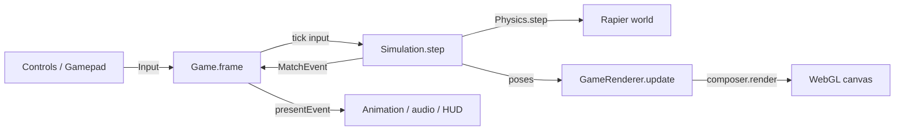
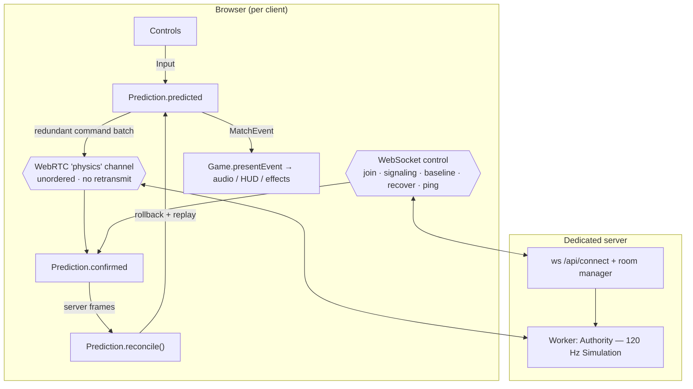

# Architecture

Champions Field is a local-first car-soccer game built on Three.js (rendering) and Rapier (physics). The same TypeScript codebase runs in two configurations:

- **Offline** — a single browser tab owns the whole match and drives the opponent with a bot.
- **Online 1v1** — a Node worker is authoritative; each browser runs a confirmed copy plus a predicted copy of the world.

Both configurations are driven by **one shared headless simulation**. That sharing is the central architectural decision: offline practice and online play cannot quietly diverge if they step the same code with the same constants ([ADR-0002](adr/0002-shared-headless-simulation.md)).

This document describes structure and data flow. For per-file descriptions see [modules.md](modules.md); for the reasoning behind specific choices see the [ADRs](adr/).

## 1. Layering

```
┌───────────────────────────────────────────────────────────────┐
│ Presentation  (render.ts, stadium*, effects, hud, audio, dom)  │  Three.js + DOM/CSS
├───────────────────────────────────────────────────────────────┤
│ Simulation    (simulation.ts)                                  │  headless, no renderer/DOM
├───────────────────────────────────────────────────────────────┤
│ Physics       (physics.ts, ball-physics.ts, arena.ts)          │  Rapier world + tuned model
└───────────────────────────────────────────────────────────────┘
        ▲                                         ▲
        │ extends / wraps                         │ wraps
   Game (offline)                          Authority (server)  +  Prediction (client)
```

Dependency rules:

- `physics.ts` and `simulation.ts` must not import Three's renderer, the DOM, or any presentation module. They use Three **math types only** (`Vector3`, `Quaternion`), which is why they run unchanged under Node.
- `simulation.ts` owns match rules and emits `MatchEvent`s. It never plays sound, spawns particles, or touches the HUD.
- Presentation modules read simulation state each frame and consume events. They never mutate simulation state.

`Game` (`game.ts`) is the only class that implements **both** the simulation host role and the presentation host role. It does this by extending `Simulation` and owning a `GameRenderer`.

## 2. The fixed-step loop

Everything gameplay runs at a fixed **120 Hz**. `STEP = 1/120` in `config.ts`; `Physics` and `Simulation` both advance by exactly one `STEP` per tick.

Render frames are decoupled and variable-rate:

```
Game.frame(now):
  dt = clamp((now - previous)/1000, 0, 0.05)
  accumulate dt
  while accumulator >= STEP: tick(input); accumulator -= STEP     // offline
  view.update(dt, phase, celebration, alpha)                       // interpolate + draw
```

- Offline uses a catch-up accumulator. Jump edges are preserved until a step actually consumes them (`controls.restoreJump()`).
- Online does **not** use a wall-clock accumulator. `OnlineClient.update()` decides each frame how many ticks to advance from the target-server-tick model, then calls `Prediction.predict()` in a bounded loop (max 8 ticks/frame).

Presentation interpolates between the previous and current physics poses using `alpha` (the fractional step the offline accumulator holds). This keeps motion smooth at any refresh rate without ever feeding render delta back into physics.

## 3. Match lifecycle

`Simulation` is a small state machine over `phase`:

```
ready ──start──▶ countdown ──3s──▶ playing ──goal──▶ goal ──4.6s──▶ playing
                                        │                              │
                                        ├─ clock 0 & tied ─▶ overtime ──┘
                                        └─ clock 0 & lead ─▶ ended
```

- Kickoff `start` is an explicit argument to `step(inputs, start)`; online, the server sets it when both seats are ready (and both requested a rematch).
- The goal phase holds the clock, disables the ball, and fires `physics.goalBlast()` at `phaseTime <= 4.38` (the celebration origin is captured in `Simulation.celebration`).
- Practice mode (`practice = true`) skips countdowns, runs untimed, and sets `remaining = 0`.

Gameplay-relevant state lives on `Simulation` (`MatchState`) **and** on `Physics`. A full `Checkpoint = { physics, match }` captures both. The digest of that state is what online clients compare.

## 4. Determinism strategy

Determinism is a hard requirement because online prediction rolls back and replays physics.

- **Pinned engine.** `@dimforge/rapier3d-deterministic-compat@0.19.3` precisely, not a caret range ([ADR-0003](adr/0003-pinned-rapier.md)).
- **Fixed order.** Both cars are always stepped in canonical slot order `[0, 1]` (`player`, `bot`), independent of who is local. Never "my car first".
- **Canonical inputs.** `canonicalInput()` quantizes every analog axis to signed 16-bit (`Math.round(v * 32767)/32767`) and coerces buttons to booleans, so the server and client simulate byte-identical commands.
- **Build identity.** `__SIM_BUILD__` is a SHA-256 over every `src/**/*.ts` file plus `package-lock.json`, truncated to 20 hex chars (`scripts/build-id.mjs`). Vite bakes it into the browser bundle and esbuild into the server bundle. A join whose build does not match is rejected ([ADR-0005](adr/0005-build-id-gating.md)).
- **Explicit arena roles.** Rapier 0.19.3 can cache a bogus JS `Collider.parent()` for an unattached collider after deserialization (`undefined handle → NaN → arena index 0`). Arena colliders are therefore recorded explicitly at construction (`physics.isArenaCollider`); gameplay roles are never inferred from the wrapper cache after a rollback.
- **Digest, not auth.** `Simulation.digest()` hashes gameplay-relevant state only (`matchState()` + `physics.canonicalState()`) with two 32-bit hashes (FNV-1a and djb2). It detects drift; it is not an authentication or anti-cheat primitive.

A known limit: full-snapshot replay has shown one unresolved fresh-world hash difference while observable state matched. See [multiplayer-plan.md](multiplayer-plan.md) and [ball-physics-parity.md](ball-physics-parity.md) for measured caveats. Do not claim bitwise replay determinism.

## 5. Offline data flow



`Game.tick()` supplies the local `Input` and a bot `Input` (`botInput()`). `Game.presentEvent()` maps events to audio, particles, HUD messages, and camera shake. Because offline `Game` **is** the simulation, `this.blue`, `this.remaining`, etc. are read directly by the HUD.

Bots are just another input producer; `physics.botEnabled` turns the second car into an opponent.

## 6. Online data flow



Two transports, by design ([ADR-0006](adr/0006-webrtc-transport.md)):

- **WebSocket (`/api/connect`)** — JSON control plane: join/auth, WebRTC signaling (`description`, `candidate`), full baselines (binary, gzip, first byte `0x1f`), reliable catch-up (`recover`), `ping`/`pong`, seat/room events.
- **WebRTC data channel `physics`** — reliable-in-order **off**, `maxRetransmits: 0`, negotiated `id: 0`. Carries the redundant input batches (client→server) and authoritative frames (server→client). A lost old packet never blocks a newer one.

### Client lifecycle

1. `OnlineClient.connect()` opens the WebSocket and sends `join {room, token, build}`.
2. On `welcome`, it creates the `Prediction` (confirmed + predicted sims) and the `RTCPeerConnection`. Chrome creates the offer so it owns ICE nomination, including TCP-TURN fallback.
3. The server sends a gzip baseline. `OnlineClient.baseline()` restores both sims to the same checkpoint, so the predicted sim starts from confirmed truth.
4. `markReady()` signals the server and requests any frames after the baseline tick.

### Each render frame (`OnlineClient.update`)

1. If not ready, keep requesting baselines on a timer.
2. Stall detection: no frames for 3 s → close; no `update` for 500 ms → resync; confirmed tick stuck for 1.5 s → resync.
3. `Prediction.reconcile()` consumes pending server frames in order (bounded to 64 iterations).
4. A target tick is computed from the ping anchor: `floor(anchorTick + (now - anchorTime + rtt) * 0.12 + 3)`, clamped to `authoritative + 48`. The `0.12` factor is the server's 120 Hz tick rate.
5. Advance the predicted sim toward the target (max 8 ticks/frame), sending the recent 12 commands every other tick while the channel's buffer is below 8192 bytes.
6. Send `recover` when frames are missing; send `ping` about once per second.

`window.multiplayerStatus()` (dev/ops aid) exposes state, RTT, ticks-ahead, prediction stats, and resync reason.

### Reconciliation and correction

`Prediction` holds:

- `confirmed` — steps **only** server-applied inputs in order. Never touched by local prediction.
- `predicted` — applies local input immediately and predicts the opponent's held input for the unknown future.

`reconcile()` flags a difference when **either**:

- the applied inputs for a tick differ from what the client predicted (immediate reaction to a surprise jump/steer/boost), **or**
- the every-8-ticks digest differs, **or**
- a `start` flag or a confirmed-tick gap appears.

Correction restores the predicted sim from a **complete confirmed checkpoint** (engine solver state + car controller + pads + timers, not just body poses), then replays local commands up to 64 ticks. Corrections are measured at the **same tick** so ordinary motion is not counted as error (`CorrectionSample`).

Presentation error is separate: `GameRenderer.correctNetwork()` accumulates decaying rotation/position offsets (65 ms time constant) and snaps on large errors (> 3 m or > 1.6 rad tracking) or kickoff teleports.

## 7. Physics model

`Physics` (`physics.ts`) owns a Rapier `World` and constructs:

- the arena collision mesh (`arena.ts`), static,
- two `Car` bodies with four suspension wheel traces,
- one ball body with **two** sphere colliders (see below),
- boost pads.

Notable design points:

- **Dual-mask ball colliders.** Rapier's JS API has no solver-material hooks, but RocketSim parity needs different ball/car and ball/world materials. Two coincident sphere colliders share the ball body with mutually exclusive collision masks (`COLLISION_GROUPS`); only one can resolve any pair. The second has zero mass so inertia is unchanged. Both handles are restored in checkpoints. See [ball-physics-parity.md](ball-physics-parity.md) and [ADR-0007](adr/0007-ball-material-split.md).
- **RocketSim-derived tuning.** Speed, gravity, jump, boost acceleration, air torque/damping, steering and coast-friction curves, dodge impulse, and the ball hit curve are derived from RocketSim reference values scaled into this world (`config.ts`, `ball-physics.ts`, curve tables in `physics.ts`).
- **Checkpoints.** `physics.checkpoint()` returns the Rapier snapshot bytes plus car memory (jump/flip/boost/recovery/contact state), collider handles, pad cooldowns, and flags. `physics.restore()` rebinds wrapper handles after restoring the world.

## 8. Rendering pipeline

`GameRenderer` (`render.ts`) owns the scene, camera, renderer, and an `EffectComposer`. Pass order:

```
RenderPass → SceneDepth → GTAO occlusion → CinematicMotion → Bloom → Blast → SMAA → Grade → Output
```

Quality tiers (`performance | high | ultra`, persisted as `champions-field.quality`) are one switch controlling pixel ratio (1 / ≤1.5 / ≤2), bloom, ambient occlusion, SMAA, grass/sky/atmosphere visibility, shadow-map size (2048 / 4096), and the sun profile.

The camera is a `FollowCamera` with an analytic critically damped spring so response is identical at 30, 60, or 144 Hz. It frames the car and ball, prioritizes ball visibility in ball cam when both cannot fit, keeps the boom above the floor, and lets the lens pass through transparent ramp/wall backs.

`GameRenderer.prepareGraphics()` warms shaders, textures, and effect geometry offscreen during the loading screen so the first explosion or demolition does not trigger a scene-wide recompile.

`GameRenderer.syncCar()` translates simulation car state into visuals: interpolated pose, wheel spin/steer, brake lights, exhaust heat, boost style, speed trails, and turf debris/grass compression.

## 9. Input and bindings

`Controls` (`controls.ts`) merges keyboard events and polled Gamepad API state into a single `Input`.

- Actions and defaults live in `bindings.ts` (`ACTIONS`), grouped as driving / aerial / match.
- Bindings persist to `localStorage` under `champions-field.controls.v1` and are validated on load (`validKey`, `validPad`).
- Edge-triggered one-shot actions (`jump`, `pause`, match actions) fire on press; held actions (`lookLeft/Right`) read continuously. A gamepad "blocked" flag suppresses stale input until the pad goes neutral after focus/menu changes.
- Rebinding capture and menu navigation are handled here and rendered by `controls-menu.ts`.

## 10. Build, tooling, deployment

```
npm run dev      vite --host 127.0.0.1 --port 5179 --strictPort   (proxies /api → :8787, ws)
npm run build    tsc --noEmit && tsc -p tsconfig.server.json && vite build && node scripts/build-server.mjs
npm run start:server   node dist-server/index.mjs
```

- `tsconfig.json` covers `src` (browser, DOM lib). `tsconfig.server.json` extends it for `server` plus the shared `simulation.ts` and `network/{authority,prediction,protocol}.ts` only — the server must not pull in presentation code.
- `scripts/build-server.mjs` bundles the three server entry points with esbuild (Node 22, ESM, `packages: external`) and injects the same `__SIM_BUILD__`.
- Vite auto-splits `physics-engine` (Rapier) and `three-renderer` chunks.

Deployment (`deploy/`, `Dockerfile.alpha`) runs the game behind an Nginx Unix-socket proxy with coturn and Traefik TLS. The `Dockerfile.alpha` builds `node-datachannel` against **libnice** because the default libjuice backend rejects Chrome TCP-TURN checks with a zero-valued ICE tiebreaker. Operational details are in [multiplayer-alpha.md](multiplayer-alpha.md).

## 11. Where to make a change

| You want to… | Start at |
| --- | --- |
| Tune handling/speed/gravity/jump | `src/config.ts`, then `src/physics.ts` curve tables |
| Change ball behaviour | `src/ball-physics.ts`, `src/physics.ts` |
| Add/modify a match rule or event | `src/simulation.ts` (emit), `src/game.ts` (`presentEvent`) |
| Add a netcode field | `src/network/protocol.ts` (encode/decode + `canonicalInput`), then `authority.ts` / `prediction.ts` |
| Change server policy/limits | `server/index.ts`, `server/room.ts` |
| Add visuals or a post effect | `src/render.ts` pass list, plus the relevant `src/*-pass.ts` |
| Change controls or defaults | `src/bindings.ts`, `src/controls.ts` |
| Change the HUD | `src/hud.ts`, `src/match-hud.css`, `src/style.css` |
| Change the stadium/scenery | `src/stadium.ts`, `src/stadium-presentation.ts`, `src/arena.ts` |
